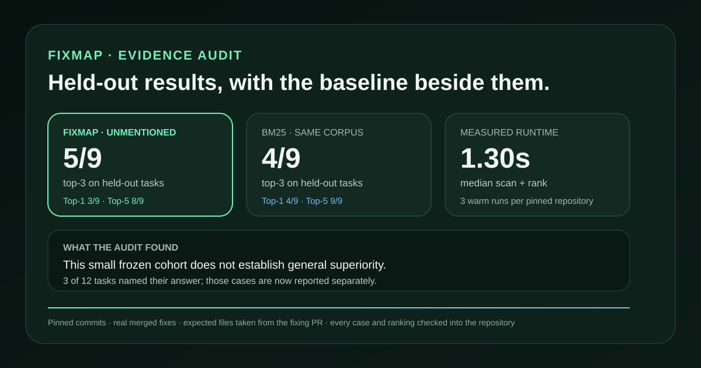

# Benchmark analysis of 2026-08-13 (archived)

> Archived on 2026-11-25. These figures were measured on 2026-08-13 with that day's ranker and are kept unchanged as the record of that analysis. Current results, and how they compare with these, are in [docs/BENCHMARKS.md](../BENCHMARKS.md).

## Cross-repository ranking and efficiency




Two suites answer two different questions. The [regression suite](../../benchmarks/external/README.md) uses 16 repositories whose cases have guided ranking work, so it measures fit rather than generalization. The [held-out suite](../../benchmarks/heldout/README.md) uses 12 further repositories selected by the identical frozen rule and rotates any case that informs a ranking change, so it remains unseen evidence. Each case in both pins the repository state before the fix and freezes the fixing source paths before FixMap ranks anything.

Ranking outputs verified 2026-08-13 on Node v24, Windows 11, Intel Core i5-8350U; the scan-time measurement remains from 2026-07-26:

| Quantity | Held-out (12) | Regression (16) | Evidence type |
| --- | ---: | ---: | --- |
| Expected fixing file in Top-1 | 6/12 (50%) | 11/16 (69%) | Measured, **pooled — see cohorts below** |
| Expected fixing file in Top-3 | 8/12 (67%) | 16/16 (100%) | Measured, **pooled — see cohorts below** |
| Expected fixing file in Top-5 | 8/12 (67%) | 16/16 (100%) | Measured, **pooled — see cohorts below** |
| Median scan + rank time | — | 1,747.7 ms | Measured, three warm runs per pinned repository |

**The held-out, unmentioned cohort below is the one to plan around.** The pooled held-out column includes three tasks that name their fixing file, while the regression column describes performance on cases that shaped the ranker.

### Cohorts: tasks that already name the fixing file

Some benchmark tasks contain a fixing path in the task text — `Location: lib/document.js:2339` in
the mongoose case, and GitHub permalinks to the exact file and line range in the svelte and yargs
cases. A ranker with an explicit-file-mention signal answers those by reading the task rather than
by searching the repository, so pooling them into a single rate lets a handful of cases carry a
generalization headline.

Classification is derived at evaluation time by
[`scripts/lib/expected-path-mention.mjs`](../../scripts/lib/expected-path-mention.mjs) from the same
task text the ranker reads — never stored in `dataset.json`, where it would drift from the case it
describes. Three tiers are recorded: a repository-root-anchored full path (including inside a
`github.com/<owner>/<repo>/blob/<ref>/<path>` permalink), a multi-segment path suffix such as a
`tsc` error naming `src/query/react/buildHooks.ts`, and a bare basename. The first two count as
named; a bare `index.ts` is ordinary prose in an issue and does not.

| Suite | Cohort | Cases | Top-1 | Top-3 | Top-5 |
| --- | --- | ---: | ---: | ---: | ---: |
| Held-out | Task did not name the file | 9 | **33.3%** (95% CI 12–65%) | **55.6%** (95% CI 27–81%) | 55.6% |
| Held-out | Task named the file | 3 | 100% | 100% | 100% |
| Held-out | Pooled | 12 | 50.0% | 66.7% | 66.7% |
| Regression | Task did not name the file | 13 | 69.2% | 100% | 100% |
| Regression | Task named the file | 3 | 66.7% | 100% | 100% |
| Regression | Pooled | 16 | 68.8% | 100% | 100% |

**Read this as a structural correction, not a measured effect size.** The regression suite barely
moves under the split, and its named cases are 2/3 rather than 3/3 — so being named does not
guarantee a hit. With three cases per named cohort, how much a mention is worth is not established.
What is established is that a generalization headline should not be computed over tasks that
contain their own answer.

## Baseline-relative ranking

A hit rate published on its own does not answer the question a reader actually has: is this better
than what an agent already gets by searching the repository itself?
[`scripts/evaluate-baseline.mjs`](../../scripts/evaluate-baseline.mjs) scores naive arms and FixMap on
**one `scanRepo()` result per case, shared by every arm**.

### Candidate policy is the confound, not the ranking function

FixMap does not rank the raw scan. `rankContextFiles` gates on `isSource && !isTest` (minus
lockfiles, excluded and generated paths) and then deprioritises documentation for a task that is not
about documentation. A baseline pointed at every scanned file competes on a larger, doc-heavy
population and returns `README.md`, `CONTRIBUTING.md` and issue templates first — it loses to
documentation, not to FixMap.

An earlier revision of this page did exactly that and reported FixMap beating BM25 at p = 0.004.
That number was an artifact of the handicap and has been withdrawn.

Each baseline is now run under three candidate policies and reported **at its strongest**:

| Policy | Candidate set |
| --- | --- |
| `raw` | Every scanned file. Kept only for reference; ranks READMEs first. |
| `source` | `isSource && !isTest` — FixMap's own gate. |
| `code` | `isSource && !isTest && kind === "code"` — also drops documentation, as FixMap's scoring effectively does for implementation tasks. |

| Arm | What it does |
| --- | --- |
| `path-extraction` | Path-shaped tokens pulled from the task text, resolved against the corpus. Prices what the task was carrying. |
| `lexical-literal` | Literal keyword search: distinct query terms matched, then raw occurrence count. |
| `bm25` | Standard BM25 (k1 = 1.2, b = 0.75). A retrieval baseline, **not** a grep. |
| `fixmap` | `rankContextFiles`, which applies its own gate internally. |

Both keyword arms are case-insensitive and expand camelCase, which favours the baselines.

### Held-out, tasks that did not name the file (9)

| Arm | Top-1 | Top-3 | Top-5 |
| --- | ---: | ---: | ---: |
| `path-extraction` (any policy) | 0.0% | 0.0% | 0.0% |
| `lexical-literal:raw` | 11.1% | 22.2% | 33.3% |
| `lexical-literal:code` | 22.2% | 44.4% | 77.8% |
| `bm25:raw` | 11.1% | 22.2% | 33.3% |
| `bm25:source` | 11.1% | 22.2% | 44.4% |
| **`bm25:code`** | **44.4%** | **55.6%** | **100%** |
| `fixmap` | 33.3% | 55.6% | 55.6% |

**FixMap does not beat BM25-over-code on repositories it was never tuned against.** BM25 leads the
Top-1 point estimate 4/9 to 3/9, while Top-3 is tied at 5/9; both paired comparisons have McNemar
p = 1.0. At Top-5 the baseline wins four cases FixMap misses and FixMap wins none — BM25 has the
fixing file in its top five for 9 of 9 cases, FixMap for 5 of 9 (McNemar p = 0.125).

The four FixMap misses BM25 catches are `jestjs/jest`, `knex/knex`, `vitejs/vite`, and `vuejs/core`.

### Regression, tasks that did not name the file (13)

| Arm | Top-1 | Top-3 | Top-5 |
| --- | ---: | ---: | ---: |
| `lexical-literal:code` | 30.8% | 30.8% | 30.8% |
| `bm25:source` | 23.1% | 38.5% | 38.5% |
| `bm25:code` | 38.5% | 61.5% | 61.5% |
| **`fixmap`** | **69.2%** | **100%** | **100%** |

FixMap leads here, but this is the suite whose cases shaped the ranker, and the lead is **not
significant** against `bm25:code`: p = 0.125 at Top-1 and p = 0.0625 at Top-3 and Top-5.

### Paired tests

Arms are compared with **McNemar's exact test** rather than by comparing Wilson intervals: the arms
ran on the same cases, and that pairing carries information independent intervals discard.

| Suite | FixMap vs | Top-1 | Top-3 | Top-5 |
| --- | --- | ---: | ---: | ---: |
| Regression (13) | `lexical-literal:code` | 0.0625 | 0.0039 | 0.0039 |
| Regression (13) | `bm25:code` | 0.125 | 0.0625 | 0.0625 |
| Held-out (9) | `lexical-literal:code` | 0.625 | 1.0 | 1.0 |
| Held-out (9) | `bm25:code` | 1.0 | 1.0 | 0.25 (baseline ahead) |

Nine and thirteen cases cannot settle this either way; what they do show is that the previously
published margin does not survive a fair baseline. Growing the held-out suite and closing the Top-5
recall gap are the work this points at.

The dated narrative is in [the benchmark self-audit](releases/2026-08-04-benchmark-self-audit.md).

`path-extraction` scoring 0.0% on the unmentioned cohort of both suites and 100% on the named
cohort is the independent check that the cohort classifier measures what it claims.

```bash
node scripts/evaluate-baseline.mjs --suite heldout
node scripts/evaluate-baseline.mjs --suite external
node scripts/evaluate-baseline.mjs --suite heldout --record
```

Per-arm, per-policy rankings for every case are recorded in `benchmarks/<suite>/baseline-results.json`.

